Readme · MD

  
 

---
 
## root@speeziq:~# cat about.txt
 

  

---
 
## root@speeziq:~# ls skills/
 

 

 

  
 

---
 
## root@speeziq:~# ./what_i_do.sh
 

  

---
 
## Areas of Focus
 
- **Reconnaissance & OSINT**: information gathering and attack surface mapping
- **Web Application Pentesting**: OWASP Top 10, authentication, access control, injection flaws
- **Network & Infrastructure Testing**: service enumeration, misconfigurations, privilege escalation paths
- **Reverse Engineering**: static and dynamic binary analysis, disassembly, debugging, understanding program internals
- **Software Development**: building clean, secure and well-tested software in C/C++, Python and PHP
- **Security Tooling**: custom scripts and tools in Python and C/C++
- **Reporting**: clear, actionable findings with remediation guidance
---
 
## GitHub Stats
 

---
 
## Connect With Me
 

<!-- Uncomment and edit the ones you use:

-->
 

---
 

 

